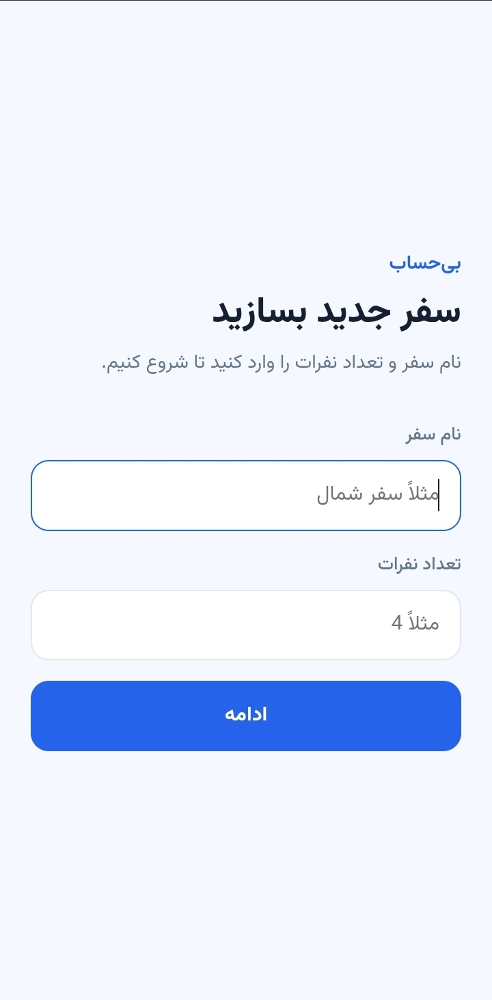
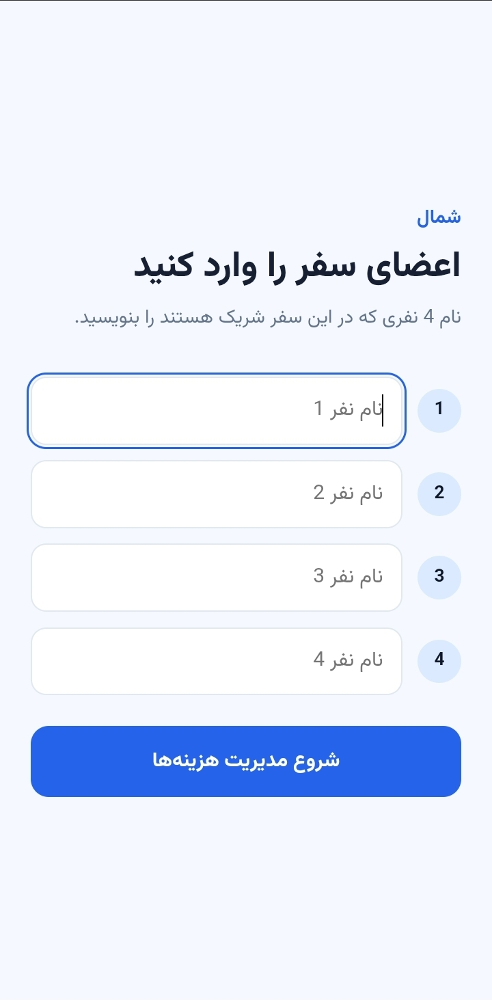
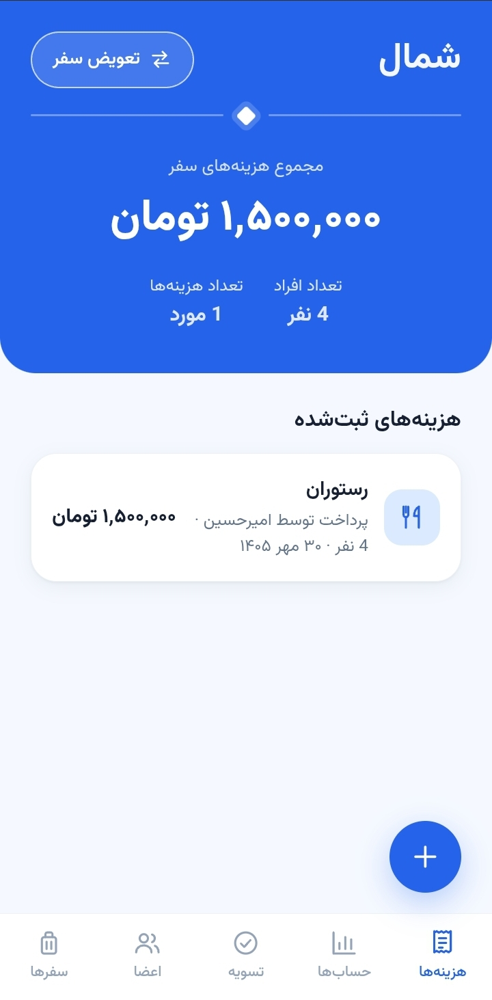
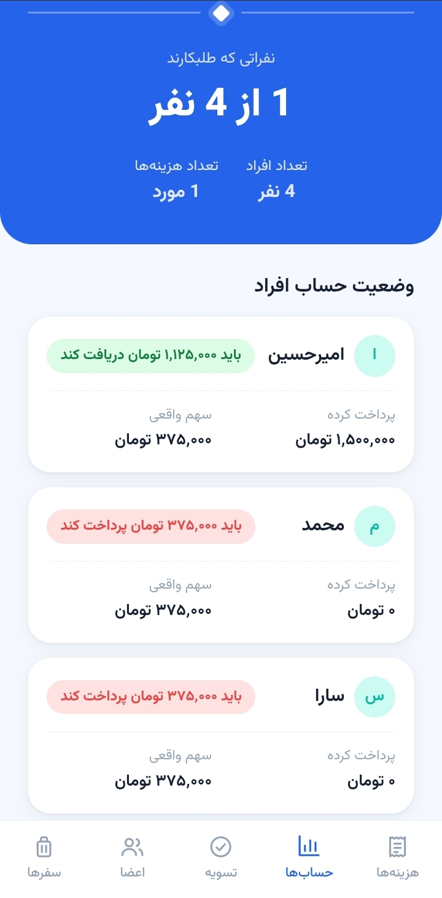

# 🏕️ بی‌حساب (Bihesab) - اپلیکیشن محاسبه دونگ سفر

یک برنامه سبک و چندسکویی (Cross-platform) برای محاسبه و تقسیم آسان هزینه‌های سفر و تسویه‌حساب بین دوستان. این پروژه با تکنولوژی‌های استاندارد وب ساخته شده و با استفاده از Capacitor به اپلیکیشن بومی (Native) اندروید تبدیل شده است.

## 🚀 دمو و دانلود
* 🌐 **نسخه تحت وب (آنلاین):** [https://amirzakhani.ir/bihesab]
* 📱 **دانلود نسخه اندروید (کافه‌بازار):** [http://cafebazaar.ir/app/?id=ir.amirzakhani.bihesab&ref=share]

## 🛠️ تکنولوژی‌های استفاده شده
* **فرانت‌اند (Frontend):** HTML5, CSS3, Vanilla JavaScript
* **تبدیل به موبایل (Mobile Packaging):** Capacitor
* **ذخیره‌سازی داده‌ها:** LocalStorage API

## ✨ ویژگی‌ها و امکانات
* امکان افزودن اعضای گروه به سفر و ثبت پویای هزینه‌ها
* محاسبه دقیق بدهی‌ها و مشخص کردن سهم هر فرد در تسویه‌حساب
* رابط کاربری ساده، تمیز و کاملاً واکنش‌گرا (Responsive)
* قابل اجرا به صورت وب‌اپلیکیشن و اپلیکیشن مستقل اندروید

## 📸 تصاویر محیط برنامه

  
  
  
  

